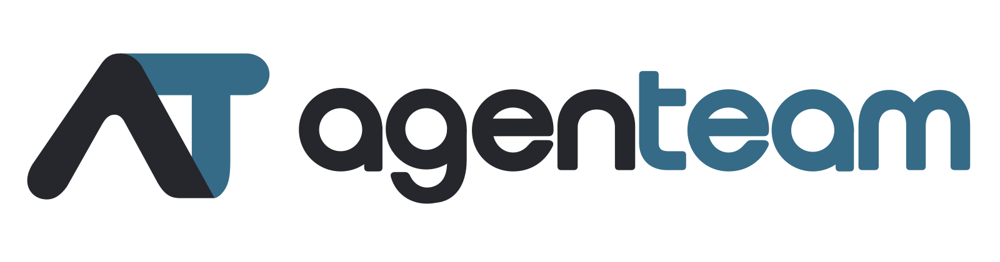

# agenteam

<picture>
  <source media="(prefers-color-scheme: dark)" srcset="docs/logos/agenteam-horizontal-dark.svg" />
  
</picture>

agenteam 是以项目为边界的 AI Agent 协作与执行平台，管理长期项目状态、任务、会议、Agent 执行与人类审核。

全局开发状态见[任务台账](docs/development/agent-team/tasks.md)，跨设备继续当前任务见[自动保存与接续](.agent-state/README.md)，AI 协作规则见[团队流程](docs/development/agent-team/README.md)。README 保留项目介绍与使用入口，逐轮进度不再在此重复维护。

## 技术基线

- 前端：Vue 3 + 自定义组件。
- 后端与远程执行节点：Go，单个 Central + 多个 Runner。
- 存储：PostgreSQL / pgvector + MinIO。
- 本地开发：Docker Compose 管理 Central 与基础设施，nginx 提供前端并反代 API；生产前端嵌入尚未验收。

仓库包含 Vue 前端、共享组件与开发环境 Debug 展示，以及 Go Central/Runner、PostgreSQL/pgvector 和对象存储相关模块。已交付能力、尚未绑定端口与验收限制统一见任务台账；完整产品尚未就绪。

## 后端开发

### 本地 Docker Compose 开发环境

安装 Docker Engine 与 Docker Compose v2，在完整仓库根目录准备本地配置：

```sh
cp .env.example .env
```

按需修改 `.env` 中的开发凭据、端口和首次运行的 UID/GID，然后一条命令构建并启动完整开发环境：

```sh
docker compose -f docker-compose.dev.yaml up -d --build --wait --wait-timeout 1200
```

Compose 自动读取根 `.env`，可调项及默认值见 [.env.example](.env.example)；已有 shell 环境变量优先。首次下载镜像和 Go/npm 依赖需要网络与足够磁盘空间。命令会等待数据库、对象存储初始化和真实 Central 监听；成功后访问 **http://localhost:8080**（若修改 `AGENTEAM_DEV_PORT`，使用对应端口）。只有这个网页端口绑定宿主机 loopback，数据库和 MinIO 均不公开宿主端口。

使用 Docker `vfs` 存储驱动时，应另留容器文件系统的空间：本次四服务配置（MinIO 使用本地同版本镜像覆盖）的实际运行容器额外占用约 3GB，此外还有 `.dev` 中的编译和依赖缓存；这不是所有环境的峰值或空间上限。

只有四个服务：`database`（PostgreSQL/pgvector）、`minio`（对象存储）、`app`（Central）和 `web`（前端与 API 反代）。数据库由原镜像自动初始化；app 启动时准备本地目录、固定机器标识及五组独立随机密钥，随后降为配置的 UID/GID 编译并运行 Central。**bucket 是 MinIO 中存放对象的容器，不是另一个服务。** Central 仅在新数据库的存储身份仍为 `reserved` 时创建缺失的配置 bucket；已确认身份的旧数据库缺桶会拒绝启动，防止掩盖数据丢失。已有 bucket 仍须通过完整安全检查，不改策略、版本管理或生命周期规则。没有独立初始化容器或 mc 依赖。

工具链镜像包含 Go 1.27.1 / Node 24.12.0，不打包项目源码。`up --build` 会复用未变的构建缓存；应用每次启动都从只读挂载的当前源码编译 Central、安装或复用锁定的前端依赖并构建页面，再运行真实入口。编译失败会停止应用，页面返回 503，不运行旧二进制。工具链未变时，日常修改源码只需：

```sh
docker compose -f docker-compose.dev.yaml restart app
```

这会重新构建当前 Go 和前端源码；等应用重新监听后刷新页面。修改 `.env` 属于**容器配置变更**，`restart` 不会重新读取它，应再次执行上面的 `up -d --build --wait --wait-timeout 1200`，让 Compose 更新相应容器。网页监听端口和 Central 的 `PUBLIC_ORIGIN` 使用同一个变量，不会写死在首次生成的凭据里；反代保留原 Host/Origin，并跟随重建后的 app 地址。须使用显示的精确 `localhost` 地址，HTTP 安全边界不变。开发用 nginx 不代表生产 SPA 嵌入已完成；`/livez` 用于已监听进程检查，当前产品的 `/readyz` 仍返回 503。

若开发网络需要额外受信 CA，先执行以下可选构建，再使用上述启动命令。普通环境无需这一步：

```sh
docker build --no-cache --secret id=dev_ca,src=/path/to/trusted-ca.crt -f Dockerfile.dev -t agenteam-dev-toolchain:go1.27.1-node24.12.0 .
```

输入应为不含私钥的 PEM 受信 CA；它加入开发镜像的系统信任库，供包管理器、Go 和 Node/npm 正常校验证书。`--no-cache` 确保证书变更实际应用，不关闭 TLS 校验。

所有持久数据与开发产物都在已忽略的根 `.dev/`：数据库、对象存储、五组独立随机密钥、固定机器标识、Object spool/ProcessGuard、Account 恢复日志、依赖缓存、唯一前端依赖目录、页面和二进制。原 Central 自行执行内嵌迁移与安全初始化，不另跑 SQL 种子。开发内网的数据库和对象存储显式使用各自正式 `TLS_MODE=disable` 配置，不改变模型出站、DNS 或应用权限规则，不启用 Execution Runtime 或发起模型请求。

容器入口仅以 root 准备本地文件；编译和 Central 默认使用 UID/GID 1000；Linux 用户可在首次启动前按 `id -u` / `id -g` 修改 `.env`，之后复用这份 `.dev` 时保持一致。首次管理员邮箱为 `admin@mail.com`，随机口令仅记录在 `.dev/account-recovery/recovery.jsonl`。在本机查看后通过网页登录，并妥善保护该文件，不要粘贴进普通日志或提交仓库。`.env` 中的数据库、MinIO 开发凭据和 `.dev/config/keyrings.json` 中的密钥必须与数据配套保留；改端口不会重置密钥。

从旧版 Compose 的 `.dev` 升级时，先把 `.dev/config/database-password`、`minio-user`、`minio-password` 的原值填入本机 `.env` 对应项，再启动。启动器会严格读取并保留旧 `central.env` 中的五组密钥和原机器标识，不执行该旧文件；损坏或不一致会明确失败，不重生密钥。PostgreSQL 的 `POSTGRES_PASSWORD` 仅初始化空数据目录，不能靠修改 `.env` 给已有角色改密；已有数据请保留原凭据，实际轮换需同步数据库账户与配置。

```sh
docker compose -f docker-compose.dev.yaml ps
docker compose -f docker-compose.dev.yaml logs -f app
docker compose -f docker-compose.dev.yaml down
```

普通 `down` 只移除本组容器与网络，保留 `.dev`；下次 `up` 可继续使用。只有明确要丢弃全部本地数据时，才在 `down` 后整体删除 `.dev` 并重新初始化，不能只删除密钥或单侧存储。不要把 `.dev` 复制到其他工作树，也不要让两个 Compose project 共用它；`COMPOSE_PROJECT_NAME` 只隔离容器与网络名称，独立环境应使用各自的仓库目录。此配置不新增 Runner、SMTP 或模型调用能力，功能范围仍以任务台账为准。

先前已验证工具链镜像构建、重复初始化和 Central 配置校验；当时 MinIO 客户端镜像拉取被拒，整组启动未通过。本轮完整启动与重启结果待实际验证。

使用 Go 1.27.1；脚本核对精确版本并禁止自动切换工具链。

```sh
AGENTEAM_GO=/path/to/go1.27.1/bin/go sh scripts/check-go.sh
AGENTEAM_GO=/path/to/go1.27.1/bin/go sh scripts/build-go.sh
./bin/agenteam --check-config
./bin/agenteam
```

运行 Central 前须显式配置数据库 URL、五用途独立随机 cursor/Secret/download/account/Knowledge confirmation keyring、私有 MinIO bucket 的 endpoint/凭据及部署所需 CA，见 [Central 环境示例](deploy/central.env.example)。首次 reserved 存储身份可创建缺桶，已有 confirmed 身份缺桶拒绝。新增必填 `AGENTEAM_CENTRAL_ACCOUNT_KEYRING` 和 `AGENTEAM_CENTRAL_ACCOUNT_RECOVERY_LOG`；后者为专用绝对文件路径，父目录须预建为服务 UID 所有的 0700 目录，文件须为该 UID 的 0600 常规文件且禁止符号链接，文件不存在时由启动创建。spool 默认 `/var/lib/agenteam/object-spool`。`PUBLIC_ORIGIN` 正式部署须为 HTTPS，仅字面 localhost/loopback 允许本地 HTTP，反向代理须保留 canonical Host。

程序不会自动加载示例文件。`--check-config` 验证包括 Account 两项在内的当前配置，不连接、创建目录或打开恢复日志；CLI 仍保留 `scope=d05` 和 D05 help/version 标识。`--help/--version` 无需配置。首次管理员初始密码只向受限恢复日志尝试输出一次，重启不重印；仅 SMTP 未配置时邀请/reset 走该日志，配置后投递失败不回退。部署与敏感日志权限见[账号说明](docs/development/backend/account.md)。普通 Go 检查无需 Docker；真实隔离 PG/MinIO/SMTP/HTTP 与 Account 固定分组命令见[后端验证命令](docs/development/backend/README.md#构建与验证)。

Central 默认监听 `127.0.0.1:8080`，连接、迁移、首次读写检查、共享安全初始化和 Account/Mail 恢复通过后才开始监听。`/api/v1` 的账号、本人资料/头像和账户系统管理接口见 [OpenAPI](api/openapi/account.json)。`/livez` 仅报告进程存活，`/readyz` 仍返回 503；`/diagnostics` 报告各能力的实际绑定状态；接口范围及后续接入以相应 OpenAPI、开发说明和任务台账为准。`./bin/agenteam-runner` 运行未连接的 Runner，接到 SIGINT/SIGTERM 后退出。配置、日志、Mail 先于 Core 收尾和实际 join/DB 最后关闭边界见[后端开发说明](docs/development/backend/README.md)。

## 前端开发

```sh
npm ci --prefix web
npm run dev --prefix web
```

访问 [Debug 组件展示](http://127.0.0.1:5173/debug)。公共组件独立于展示页，生产构建不包含 Debug。启动、检查及组件使用见[前端开发说明](docs/development/frontend/README.md)。

## 文档

- [系统架构与模块设计](docs/architecture/README.md)
- [仓库结构与代码归属](docs/development/repository-structure.md)
- [正式开发计划与 AI 执行顺序](docs/development/development-plan.md)
- [主线程统筹的开发团队](docs/development/agent-team/README.md)
- [当前任务、阻塞与接续步骤](docs/development/agent-team/tasks.md)
- [前端设计](docs/frontend-design/README.md)
