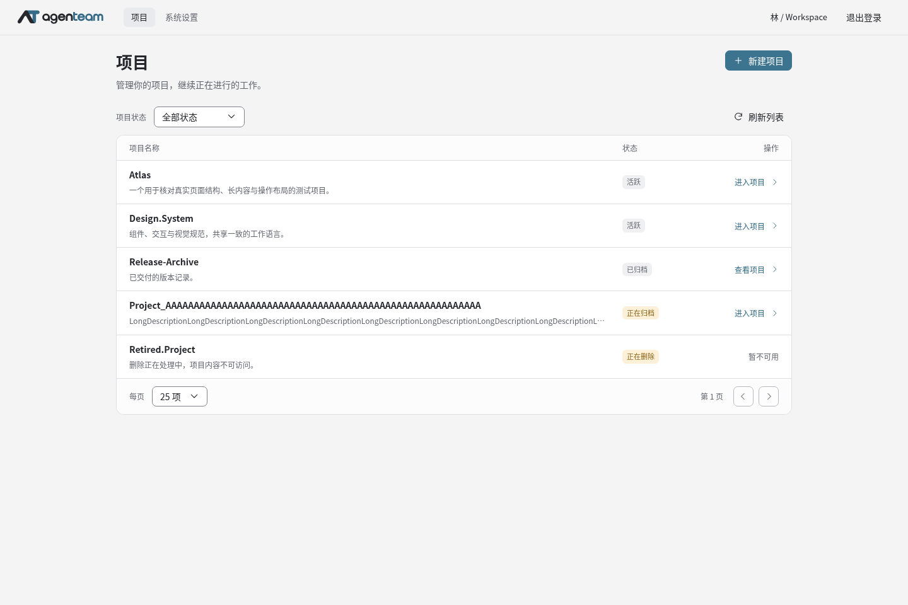
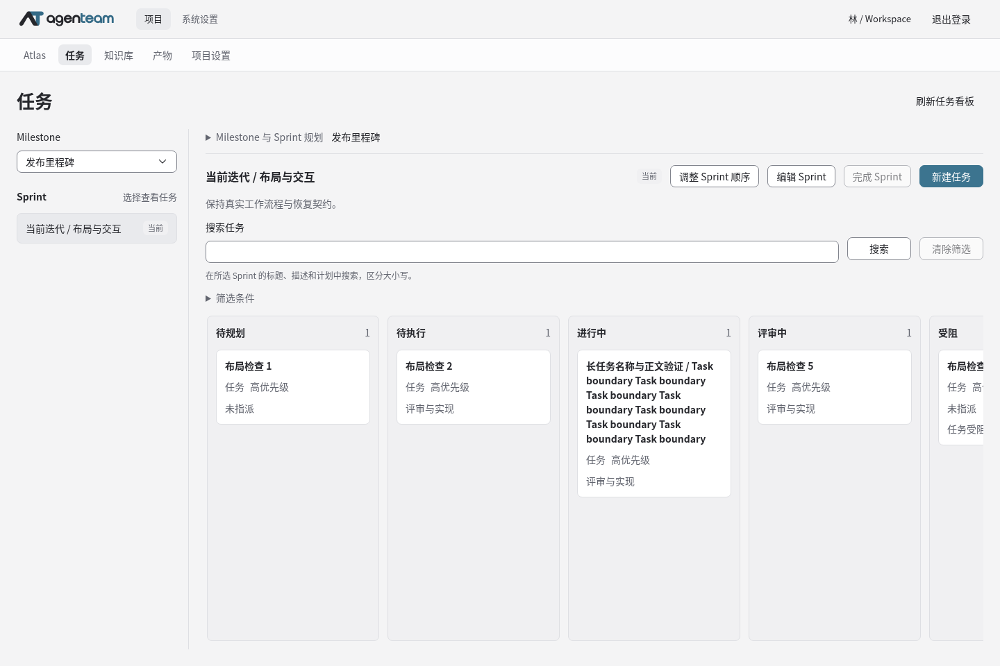
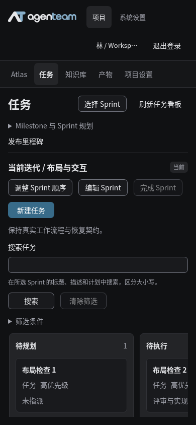
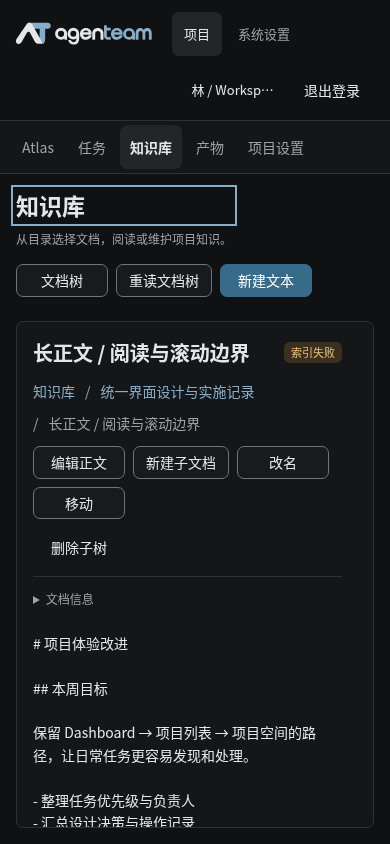

# 现状与旧规范审计

> 审计日期 2026-10-15；代码基线 `ce2f8467`。结论来自本地源码、旧规范与指定 fixture 的实际浏览器截图，非生产使用研究。行号帮助定位本轮输入，后续代码变化以符号和文件内容为准。

## 1. 结论与证据口径

**设计判断：** 当前问题不能归结为某几个控件没写好。旧文档固定了具体视觉值，而当前页面可见多种表单、状态分支和 DTO 信息纵向叠加；本轮没有发现可供这些正式页面逐一比较的已落实完整样板。这些事实支持“需要重组展示层、导航职责、信息密度和操作载体”的判断，同时保留现有业务状态机、权限与恢复逻辑。本轮没有进行完整 Git 历史因果研究，不据静态快照断言具体开发顺序或责任。

旧规范已有任务驱动、不要抄 DTO、避免卡片套卡片、真实状态和可访问性等正确要求。它也明确“组件展示验证不替代生产业务页面或真实设备验收”，允许多层表面、圆角和浮层阴影。因此不能归因为“旧规范禁止层次/阴影”或“规范允许 Debug 通过代替产品通过”。可支持的原因判断是：具体视觉锁定与页面落地、整页验收之间脱节，原则尚未在当前正式页面形成稳定可复用的组合。

证据分类：**已知**表示源码/文档或本轮特定截图直接支持；**判断**表示基于这些事实的设计分析；**待验证**表示仍需实际集成、交互或用户任务检查。下面的问题均不以“与旧规范相符”作为免责条件。

## 2. 关键问题与改造方向

| 问题 | 已知证据 | 判断与后续处理 |
| --- | --- | --- |
| 两个 Dashboard 只有空容器 | [HomeView.vue](../../../web/src/views/HomeView.vue) 约 17/34 行；[ProjectHomeView.vue](../../../web/src/views/projects/ProjectHomeView.vue) 约 36/68 行；旧 [system-pages](../layouts/system-pages.md) 约 20 行及 [project-workspace](../layouts/project-workspace.md) 约 17 行明确要求空 Dashboard；截图亦如此 | 根因包含规范占位决策。保留首页层级，改用已有项目目录、当前项目资料和真实入口；聚合指标/最近访问只在有数据依赖后增加 |
| 主要工作区被规划和操作区向下挤压 | [ProjectTasksView.vue](../../../web/src/views/projects/ProjectTasksView.vue) 约 381–783 行为多种条件恢复分支，792 行后为规划区，806/836/855/875/936/947/1008 附近有多种创建/编辑；截图见下一节 | 分支并非全部同时显示；问题是工作台把操作与流程作为连续纵向区域。将规划转上下文动作/独立任务容器，恢复提示定位到相关对象，让看板成为首屏主体 |
| Task 详情动作先于正文且继续纵向累加 | [TaskReviewDetail.vue](../../../web/src/components/work/TaskReviewDetail.vue) 的属性/动作/表单段，约 215–355 行起；详情截图可见“重新读取、编辑、调整顺序、取消、指派”集中在描述前 | 将标题、描述与当前状态作为主干；常用动作就地，管理动作菜单化，执行/依赖/历史有明确分区。保留所有状态与命令门禁 |
| 看板卡片信息权重接近 | [TaskBoard.vue](../../../web/src/components/work/TaskBoard.vue) 约 50–66 行主要为标题、类型、优先级和负责人文字；86 行附近七列固定 248px，列与卡片均有边界 | 重做卡片扫描层级、列标题和表面关系。七列横向滚动是正常工作台策略，不把“首屏未同时显示七列”本身判为缺陷 |
| Knowledge 的操作与实现术语遮住正文 | [ProjectKnowledgeView.vue](../../../web/src/views/projects/ProjectKnowledgeView.vue) 约 275–305 行动作群、367–372 行 plain/Markdown 都以 `pre` 显示；465 行附近已有 280px 目录+800px 正文结构 | 保留树与正文骨架，重做对象 header 和工具栏；安全 Markdown 渲染列入实施评估，不以样板静态 HTML 假装原文编辑已经转换 |
| Artifact 元信息和阅读体验偏原始字段 | [ProjectArtifactsView.vue](../../../web/src/views/projects/ProjectArtifactsView.vue) 约 163/166 行原 MIME、字节与 ISO 日期，230 行文本 `pre`，239 行其他类型无预览；27–43 行已有返回焦点处理 | 格式化名称、类型、大小和时间；阅读优先，完整技术信息按需展开。已有返回焦点是复用项，不声称全部需推翻 |
| 不同设置任务套相同框架后再叠加内容 | [SettingsShell.vue](../../../web/src/components/layout/SettingsShell.vue) 约 146 行固定 216+24+800/1200；[SystemProvidersView.vue](../../../web/src/views/system/SystemProvidersView.vue) 约 152/197/220 行目录后追加详情、凭据和 Models | 保留设置菜单层级，分集合、实体配置、只读诊断三类正文；Provider/Model/Credential 用明确对象导航，避免一页向下堆多个编辑器 |
| 当前值、草稿和技术记录混在主任务中 | [SystemAccountSecurityView.vue](../../../web/src/views/system/SystemAccountSecurityView.vue) 约 126–150 行“当前读取值/修改配置”；[ProjectAgentsView.vue](../../../web/src/views/projects/ProjectAgentsView.vue) 约 229–277 行多项 ID、normalized_name、引用及时间字段 | 表单直接表达用户可修改的当前值，必要比较和冲突就地出现；Agent 按身份、执行能力、资源连接和技术记录分组，不删除诊断材料 |
| 次要操作边框过密 | [旧控件规范](../styles/components-and-interactions.md) 约 22 行要求普通按钮保留边界；[颜色规范](../styles/colors-and-themes.md) 约 28 行控件边界；[components.css](../../../web/src/styles/components.css) 约 7–16/84–91 行按钮与输入边界 | 重写 quiet/default/emphasis 的动作层级和边界语义。保持必要对比度，不以取消全部边框替代设计 |
| 载体能力限制复杂内容空间 | [UiDialog.vue](../../../web/src/components/ui/UiDialog.vue) 约 9–15 行没有通用尺寸参数；[components.css](../../../web/src/styles/components.css) 约 280 行宽 560px，Drawer 约 322 行主要调整高度 | F1 核对并增强载体；短创建保留 Dialog，长期阅读/复杂详情获得更适合空间。不能假设组件已经支持设计稿中的宽度与关闭接口 |
| 模式切换缺可见选中态 | [ProjectUsageView.vue](../../../web/src/views/projects/ProjectUsageView.vue) 约 125–137 行只设 `aria-pressed`，UiButton/样式无对应视觉状态；494 行选中样式用于列表项 | 使用完整 segmented/tab 模式；键盘语义与当前模式视觉一致，保持原明细/按日汇总查询契约 |

源码规模只用于识别重组成本，不据文件行数推断性能问题。原生 `select`、password/文件输入和敏感材料 `textarea` 有合法语义，不把“换成自定义组件”本身当改造目标。

## 3. 浏览器视觉抽样

观察方式：36 个正式叶子是源码盘点；视觉抽样实际覆盖 **11 个正式路由、17 个视口/主题组合，另有 1 张 Debug 截图**。隔离 Vite 服务运行正式 Vue 页面，复用 [interface-layout.fixtures.ts](../../../tests/account-captcha-web/interface-layout.fixtures.ts) 的 synthetic HTTP fixture，通过 Chromium 截图观察。桌面样本为 **1440×960、浅色**；窄屏样本为 **390×844、深色**。这是合成内容下的界面事实，不是真实后端、实际权限执行或生产数据证明。

| 样本 | 可见事实 | 解释边界 |
| --- | --- | --- |
| `home-1440-light` / `project-home-1440-light` | 标题之外主要是空 Dashboard，项目页另有简介与基本信息入口 | 对应源码为空 section，不能解释为业务数据恰好没有活动 |
| `projects-1440-light` | 作为现有表式集合的基线 | 当前列表模式有可复用基础；不能只因较简洁就判定全站设计已完成 |
| `task-sprint-1440-light` | 标题、规划、迭代动作、搜索与帮助约占上部 350px；首张任务卡约从 y=505 开始；七列中首屏完整可见四列 | 首屏空间分配是重点；后列局部横滚本身合理，不能要求缩小文字硬塞七列 |
| `task-sprint-390-dark` | 全局头换为两行约 120px，项目导航约 54px；首张任务卡约 y=712 才出现 | 在 844px 高样本中主要任务空间很少。具体数值随内容/字体变化，后续用同 fixture 对照 |
| `knowledge-document-390-dark` | 路径和动作纵向堆叠，正文约 y=640 才开始；主动作包括“重读文档树/读取子文档/从开头重读” | 技术流程成为主要视觉内容；应改为用户任务名称并压缩结构，分段读取能力仍保留 |
| `knowledge-document-1440-light` | Markdown 的 `#`、列表标记仍以原文呈现 | 这是当前呈现事实；安全渲染、原文编辑和附件能力需分别验收 |
| `task-detail-1440-light` / `project-general-1440-light` | 详情动作群先于描述；设置主区包含名称语法、UTF-8 字节、编辑版本、重读等内容 | 必要校验不删除，技术解释下沉，错误发生时仍就近出现 |

有限键盘抽样：桌面新建项目、窄屏选择 Sprint、窄屏文档树三个弹层经 Enter 打开，连续八次 Tab 留在弹层，Escape 关闭并恢复触发焦点；未提交表单。这个基础是复用项，不代表完整可访问性通过。

本轮抽样未出现 document 级横向溢出、pageerror 或未知 API，且观察请求均为 GET；这不反证信息层级问题，也不证明写入、焦点恢复、键盘全流程或所有页面通过。并未完整遍历真实权限、Unknown、冲突和移动设备；这些属于实施阶段的定向验证。

### 留存的四张代表截图

以下均为 `ce2f8467` 的原始 Chromium 截图（2026-10-15），正式 Vue 路由配合上述 synthetic fixture；合成用户名、项目、任务及文档不是生产数据。图片仅证明指定视口呈现，未编辑、未生成替代页面。

项目列表，1440×960、浅色：保留已有有界列表与清楚状态的基础，同时校准整体排版和动作层级。

任务看板，1440×960、浅色：第一张卡片约 y=504.2；七列的局部横向滚动合理，需改善的是前置控制区占用。

任务看板，390×844、深色：系统头121px、项目导航53px，首卡约y=711.5，首屏主要被导航和控制占用。

知识阅读，390×844、深色：正文约y=640，操作先于阅读。图中的索引失败是 fixture 明确设置的合成状态，不能视为生产索引故障。

## 4. 旧规范处置矩阵

| 旧来源/规则 | 处置 | 理由与后续归位 |
| --- | --- | --- |
| [总览](../README.md)、[样式入口](../styles/README.md)把青蓝、石墨、固定尺寸及样式“已定稿”当最终基线 | **撤销此次重设计中的硬锁定；重写** | 用户要求审计规范本身；F0 用完整样板检验新方向，F1 让 v2 与实际 token 同步 |
| [字体密度](../styles/typography-and-density.md)固定 26px 页标题、统一 14px/32px/36px/46px 等 | **重写为任务化尺度** | 集合、工作台、正文和设置需要不同密度；本项目候选见目标设计，不冒称 Linear 参数 |
| 旧颜色已有多层 surface、控件已有圆角/阴影 | **保留语义能力，重新选值和使用位置** | 问题不是规范禁止层次；分组、浮层、选中与操作权重需要完整组合检验 |
| [界面设计逻辑](../interface-design.md)的任务驱动、真实字段、渐进披露与页面类型 | **保留原则，重写可落地组合与样板** | 原则正确但没有阻止功能持续向下叠加；不沿旧样板直接判断完成 |
| 旧系统/项目 Dashboard 只留空容器 | **废弃占位结论** | 信息层级保留，改为既有数据支持的概览和入口；新统计能力独立列依赖 |
| 双层导航、项目 header menu、Owner 与系统边界 | **保留语义，重写视觉和窄屏结构** | 属于用户固定层级与授权边界；不照搬 Linear Workspace/Team 侧栏 |
| 设置统一固定侧栏和居中表单模板 | **保留菜单；分集合/配置/诊断重写正文** | Provider、审计、运行信息和密码不是同一类任务 |
| 禁止眉题、会议无头像、成功仅按钮反馈等绝对表达 | **重新审定任务适用范围** | 不以装饰制造层次；有用的上下文、参与者识别和持久异步结果由实际任务判断。不是承诺全站加眉题/头像/Toast |
| Dialog/Drawer/Popover 区分、危险确认、焦点恢复 | **保留并补足组件能力** | 业务与可访问性仍有效；尺寸不应迫使复杂任务挤进一个窄容器 |
| 无假指标/无假动作、权限/只读/Unknown/冲突/迟到结果 | **保留，不受视觉重设计削弱** | 业务来源仍是架构和当前工作项，见执行计划的复用边界 |
| Debug 是共享组件参考，不能替代正式页面验收 | **保留并加强整页证据** | 旧规范已经有此规则；新增三类完整样板与真实任务旅程，不把已有通过改写成失败 |

本轮直接建立 v2 作为新设计来源，旧规范退为历史，不逐条修补旧正文。旧入口仅增加历史标记与 v2 导航；F0/F1 校准并实施 v2，继续有效的业务规则由架构和当前工作项承载，旧接受记录保持历史事实。

## 5. 待验证与不扩大结论的范围

- `ProjectKnowledgeView` 整篇区域的 `aria-live="polite"` 可能造成过多播报，需辅助技术或针对性行为检查；不能仅凭属性存在声称已出现实际读屏故障。
- 当前不同模块的“已接 API”来自源码，不能等同本轮真实 HTTP/数据库/浏览器整链通过。
- 本地没有正式 Meeting/Inbox/Memory/MCP 等路由，与 M3 功能分支历史成果并不矛盾；集成后重新核对受影响路径，避免重造已有实现。
- Dashboard 最近访问、聚合进度、跨项目待办以及跨项目搜索的数据来源未由本轮证明。布局可预留设计位置，实际页面不能先放假值或可点击占位功能。
